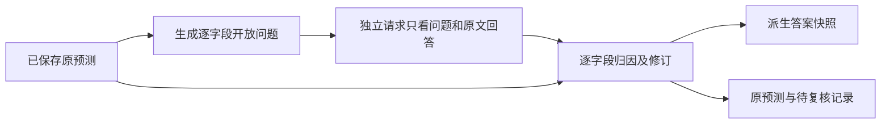

# 独立字段证据验证与冻结对照

工程 0.4.3，主动开启；普通 `verified` 默认行为保持不变。引用逐字存在，不代表它支持结论、因果和适用范围的全部断言。本流程修订实际答案，保留原预测；不把自报 supported 或自动测试通过写成提分。

## 实现与来源



借鉴 [CoVe](https://arxiv.org/html/2309.11495v2) 的问题规划、隔离候选答案的独立回答与最终修订步骤；归因分类借鉴 [AttrScore](https://aclanthology.org/2023.findings-emnlp.307/) 的完整支持、证据不足和矛盾。本项目没有训练 AttrScore 模型，也不继承论文的实验结论。相同模型的独立请求仍可能共同犯错；开放问题是否覆盖所有原子断言仍由模型判断，少量句式检查不能证明问题完全中性。

每个候选的结论、理由、边界分别生成 1～3 个问题，未说明字段也检查。第二次请求只有问题与真实原文、材料类型和节点，没有候选答案、其引用、旧复核或参考答案。第三次请求比较原字段自己的引文与独立回答，分别记录 `original_support` 和修订动作。

| 动作 | 确定性约束 |
|---|---|
| keep | 原文字和证据不变，保留规范化记录；不能掩盖不支持判定 |
| rebind | 文字不变，仅采用该字段独立回答的证据 |
| repair | 仅理由/边界，文字逐字等于独立回答，不由最终比较步骤重新编写 |
| abstain | 仅不受支持的理由可退回未说明；独立回答已有解释时不能删光 |
| hold | 保留原条目进入队列，任一字段 hold 都暂停发布整条知识；无法修复边界时不能删边界以扩大规则 |

所有最终非空字段的引文须来自自身独立 answered 回答，不能借其他字段的证据。程序核对逐字片段、正式角色归因、Agent 单独提议不能充当确认，以及引用明确理由未知时保留剩余未知；最终快照还复用已有实现标识符检查，防止独立回答引用整行、最终却只截取不含函数或路径的邻句。这些约束仍不等于完整语义证明。补充材料的身份和未知节点保留，不因文件位置或用户标记变成后续正式确认。

## 验证并保存派生答案

```bash
python3 -m decision_memory field verify \
  --dataset data/public-samples.zip \
  --result runs/original/REQUIREMENT-ID.json \
  --config config.local.toml --output runs/field-verified/result.json

python3 -m decision_memory requirement validate \
  --dataset data/public-samples.zip --result runs/field-verified/result.json
```

清单结果用 `--manifest` 替换 `--dataset`；普通单阶段的派生结果用顶层 `validate` 校验。默认目录、显式事件和 grounded 原结果先按各自协议验证，不能递归验证派生结果。每次使用新客户端和新输出路径，最多 40 条候选，不截断。正常新增 3 次模型调用；关闭 HTTP 自动重试及结构修复，失败和未知保留原回执，不在原路径自动重发。原有提取和审计的正常调用数不因此改变。

新结果为 schema 6、`independent-fields-v1` 最终快照，JSON 包含未改写的 `base_result`、问题、独立回答、逐字段判定、条目映射和 `field_review_queue`。原事件历史只放在原结果中，不伪装为修订后新历史。Markdown 展示修订及待复核内容。程序可重放修订、重新定位来源并拒绝证明/投影不一致；人工审核保持 pending。

## 冻结实测

第一轮选择本机已有的两个官方完整需求及其真实历史预测。它们已用于开发，属于公开回归，不称为未知留出集。配对比较同一份预测在字段验证前后的结果，隔离本模块的影响；不是 0.4.3 重新抽取的端到端成绩。G002～G004 的历史审计及合成压力回归单列，不混入官方参考分母。

```bash
python3 -m decision_memory field freeze \
  --dataset data/public-samples.zip --predictions runs/v0.5-req-verified \
  --config config.local.toml --judge-config judge.local.toml \
  --max-cases 2 --max-calls 14 --max-seconds 3600 \
  --output runs/field-evidence-frozen-20261117

python3 -m decision_memory field run \
  --output runs/field-evidence-frozen-20261117

python3 -m decision_memory field status \
  --output runs/field-evidence-frozen-20261117
```

`freeze` 在调用前复制 ZIP、原预测、固定参考，并绑定模型配置、全部模块摘要及提示词；任一变更阻止启动。仅产物预测没有读取全部对话，不允许混称同材料对照。原始预测为包 0.3.0 的 `v0.5-req-verified` 实验，不能冒称当前提取版本。抽取侧的来源发现仍跳过评测标注。运行可通过 `--env-file /绝对路径` 读取所需凭证变量的字面赋值，不执行 shell 文件、不保存或打印 Key。

每例分别匿名判两份视图，评分只收到条目文字、实际引文、真实原文和固定参考，不收到方法、schema、修订证明、成本或历史评分。随机标签及顺序在调用前固定；两份预测单独请求判卷，仍需人工校准模型偏差。

正常两例共 6 次验证请求、4 次独立评分请求；最多 14 次接口调用，启动时限 1 小时，累计已知输入/输出达到 40 万/7 万 token 后停止新请求，在途请求可完成。未提供价格时金额为空。`raw/`、验证 run 和 `calls.json` 保存完整回复及失败/未知；实验只运行一次，不因坏结果换目录自动重试。

报告同时记录严格完整覆盖、准确率、全部字段引文支持、条目保留量、理由退回未知数、待复核量、完整发布率及总调用。失败及含待复核条目的输出保留在案例总数和成本中；全例完整配对前不计算整批提分。不能仅靠删除低质量条目或未知字段提高分子。全例完成时，“发现改善”仅表示同批三个主指标均未下降且至少一项提高，不代表统计显著、泛化或比赛正式成绩。

程序回归及真实实验的实际状态见 `solution.md` 文末记录；凭证未注入或模型尚未运行时，报告不得填写质量比例。

2026-11-17 工程验证：新增 35 项回归，全量 411 项通过（137.599 秒），编译、锁文件及差异检查通过，157 份旧批次文件只读审计通过。模型回归全部使用虚构材料和本地 HTTP；旧模式误复用、仅产物对照冒充同材料、整行证据被截成无关邻句三处缺口均先复现失败再修正。

真实包已冻结于本机 `runs/field-evidence-frozen-20261117/`，两个需求共 20 条原预测，37 个模块摘要与 4 份冻结文件已绑定；计划摘要为 `bc58f3820d5e011626da86993105d257e5dd525da38665a667223b9e55b56453`。实际启动预检因当前进程缺少 `WQ_API_KEY` 而停止，HTTP 请求 0，状态仍为 frozen，尚无判卷或质量结论。只须补模型环境变量，无须重新冻结或重新生成参考。
