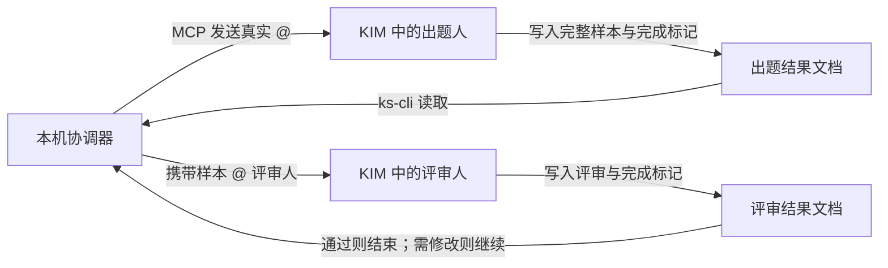

# Mario 员工在 KIM 中的多轮协作实测

2026-11-12，测试群 `7419479552888854`。

两位已创建的 Mario 员工完成了“出题 → 评审 → 修改 → 再评审”。群里保留了他们各自的回复。第二轮最后一次交接已由本机脚本完成：读取出题结果、派发评审、等待评审写回，再保存到本地。

**这次验证了实现路径。当前还没有封装从第一轮到最终结论的通用 `battle` 命令。** 前半段由 Codex 逐次调用工具派发，最后一段由脚本自动执行。

## 实际调用了谁

| 角色 | Mario 员工显示名称 | KIM 机器人 ID |
| --- | --- | --- |
| 出题人 | 命题7-出题人 | `10120718088572` |
| 评审人 | 命题7-评审人 | `10664440173316` |

通过 Mario 的 KIM 技能查询了群信息和成员。测试时群中有 1 位人类成员和上述 2 位机器人。

派发使用已连接的本机 Mario MCP：`http://127.0.0.1:38399/mcp`。先调用 `mario_list_skills`，选取 `kim-skill-assistant-cc/codex`，再通过 `mario_run_skill_task` 向指定群发送真实结构化 @。

本次技能 ID 是 `F78-f1AS46CzQ02AuOo1Q`，协调器线程是 `949696846958960653`。技能 ID 可能随账号或平台配置变化，通用实现应重新发现技能。

MCP 回执中的 `mario-agent-self-hr1t8vd2` 是派发任务的个人助手。实际生成样本和评审的是群里的两位员工，已在 KIM 界面核对。

## 多轮如何继续

每轮由本机协调器明确派发下一项任务。KIM 展示员工回复；指定 Docs 文档保存完整、可供 CLI 读取的结果。



在本次入口中，MCP 发送的消息在 KIM 显示为当前用户通过 Mario 发送，并实际触发了目标员工。这个结果只证明该入口有效，不能推广为任意机器人互相 @ 都能接力。内部 CF Remote Control 使用手册描述了 `/api/robot/send` 场景中机器人互相 @ 的限制。

当前 MCP 的 KIM 技能不支持读取群历史。两位群内员工也没有可用的 `handoff_external_agent` 工具。指定 Docs 文档提供了结果回传途径，这条实现路径不依赖它们读取群历史或调用本机 Handoff。

每轮任务应包含 `task_id`、`sample_id`、`round`、目标员工、输入材料和结果文档。协调器必须等到匹配的完成标记出现，再解析结果。消息发送成功只代表已派发，不能作为员工完成的依据。

## 本次结果与验证

测试编号：`DM-MARIO-20261112-01`。样本：`S002`。材料全部为虚构测试内容。

| 步骤 | 实际结果 |
| --- | --- |
| 出题人第一版 | 生成增量刷新方案，适用范围和全量兜底保留为待确认。 |
| 评审人第一轮 | 在新增需求澄清后要求修订，说明第一版保留未知信息在当时合理。 |
| 出题人第二版 | 明确只适用于商品详情缓存；订单系统保持原样；本期不做全量兜底，后续是否增加未定。 |
| 评审人第二轮 | 返回 `status: passed`，给出最终结论、理由和边界。 |
| 本机接收 | 脚本从 Docs 读取真实结果，保存两份输入和评审记录。 |
| CLI 输入检查 | `decision-memory inspect` 退出码为 `0`，识别到 1 个 design 样本。 |

远端结果：

- 出题人第二版，内部文档链接见本地运行记录。
- 评审人第二轮，内部文档链接见本地运行记录。

本地产物位于 `runs/mario-kim-probe-20261112/`：

- `complete_round2.py`：本次续接第二轮的临时脚本。绑定本次测试 ID 和文档，重复运行会拒绝再次派发。
- `S002/dialogue.md`、`S002/artifact.md`：从出题人文档提取的原始文本。
- `reviewer-v2-doc.md`：评审人写回的完整结果。
- `reviewer-r2-dispatch-receipt.json`：派发回执；`complete-round2.log`：执行记录。
- `summary.json`：结果状态、来源文档、文件哈希和验证范围。
- `dataset/`、`cli-inspect.json`：官方目录格式的输入副本及 CLI 检查结果。

在项目目录运行下列命令，可以再次检查输入，无需调用模型：

```bash
.venv/bin/decision-memory inspect \
  --dataset runs/mario-kim-probe-20261112/dataset
```

`passed` 是评审员工的判断，本次仅验证协作过程。评审文本对“第6轮用户澄清”的定位不准确，实际澄清是对话中的第 7 条消息。该结果不能当作正式人工标注或模型质量分数。没有执行模型提取评测，原有万擎接口的配置问题也未在本次处理。

## 封装成通用 CLI 时需要完成的部分

把本次派发和回传整理成循环：出题、等待完成、评审、等待完成；通过则结束，需修订则把实际反馈交回出题人。最多执行 3 轮，仍未通过时保存待人工确认状态。

每轮应使用独立的结果文档和唯一完成标记，并保存请求、回执及原始回复。发送超时后先核对回执或等待原结果，不能直接重发。提供恢复执行能力，避免重复派发和覆盖人工修改。

配置应包含测试群、两位员工的真实 ID、Mario MCP 地址、Docs CLI 路径和超时。延续当前账号已授权的能力即可，这个方案不需要训练模型，也不需要新增万擎或 Mytoken 密钥。

本次脚本与运行产物放在 Git 已忽略的 `runs/` 中，没有上传到 GitHub。
