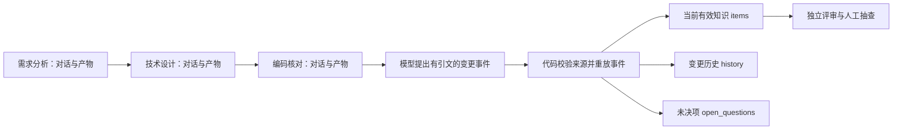

# 完整需求的知识提取与验证

## 输入和处理

`requirement` 命令通过显式清单一次读取一个已完成需求的有序节点，输出当前有效知识及变更依据。节点可以包含需求分析、技术设计、编码或测试。顶层 `extract`、`batch` 默认读取需求目录并合并分析/设计及补充 Markdown；单阶段调用需使用独立文件参数或 `--unit stage`。两种需求入口分别使用事件流与决策轨迹协议，当前保留各自的验证及历史格式；不要混用已保存结果的校验入口。



材料先后以节点顺序为准，缺少真实时间戳时不生成日期。每个节点的对话和产物都按原始行号建立索引。早期产物中的决定可以由后续节点更新或撤销。

模型判断哪些内容属于同一知识，并给出稳定的 `knowledge_key`。代码检查事件、原文引用和前驱关系，再生成当前知识。语义是否正确仍需独立评审和人工核查。

## 运行仓库示例

[示例清单](../examples/requirement-cache/manifest.json) 使用完全虚构的商品详情缓存需求，包含分析、设计和编码 3 个节点。先检查输入，无需模型凭证。

```bash
python3 -m decision_memory requirement inspect \
  --manifest examples/requirement-cache/manifest.json
```

准备好 [模型配置](../README.md#配置模型网关) 及进程环境中的凭证后，使用一个新的输出路径。

```bash
python3 -m decision_memory requirement extract \
  --manifest examples/requirement-cache/manifest.json \
  --config config.local.toml --mode verified \
  --output runs/requirement-cache-verified/result.json

python3 -m decision_memory requirement validate \
  --manifest examples/requirement-cache/manifest.json \
  --result runs/requirement-cache-verified/result.json
```

成功后生成 `result.json` 和 `result.md`。第二个命令离线检查输入摘要、引文和事件重放，不调用模型。已有输出会报错，比较实验请使用不同目录。

示例的人工核对重点如下。这些检查点用于说明预期行为，尚未构成模型效果实验。

| 材料中的变化 | 当前知识应怎样表达 | 历史应保留什么 |
|---|---|---|
| 分析阶段允许最多尝试 3 次，设计阶段改为不重试 | 刷新不重试，失败记录日志并返回 | 3 次约定及后续替换依据 |
| 多个节点重复确认订单缓存保持原样 | 保留一条范围约束，可以补充引用 | 支持该事实的节点关系 |
| 设计确认本期不做全量刷新兜底，未给理由 | 保留决定，理由为“未说明” | 确认原文，不能补写原因 |
| 报警阈值始终未确认 | 放入 `open_questions` | 原文中的待确认依据 |

## 准备自己的需求

清单只接受 `schema_version`、`requirement_id` 和 `nodes`。`nodes` 的数组顺序表示先后。每个节点包含唯一 `id`、阶段标签 `stage`，以及相对路径 `dialogue` 和 `artifact`。

```json
{
  "schema_version": 1,
  "requirement_id": "DEMO-1",
  "nodes": [
    {"id": "N1", "stage": "analysis", "dialogue": "analysis-dialogue.md", "artifact": "analysis-artifact.md"},
    {"id": "N2", "stage": "coding", "dialogue": "coding-dialogue.md", "artifact": "coding-artifact.md"}
  ]
}
```

编号使用字母、数字、下划线和连字符，长度为 1～128 个字符。阶段标签不限制为分析或设计。每个节点需要非空对话与产物；不同节点中的产物请保存为各自的文件快照。

路径以清单所在目录为根，不能使用绝对路径、`..` 或指向目录外的符号链接。程序只读取清单列出的材料，不读取同目录下的参考答案。请只在 `dialogue` 和 `artifact` 中填写原始材料。

当前限制为最多 64 个节点、单份材料 2 MB、整个需求 8 MB。模型配置的 `max_input_chars` 还会限制序列化后的请求长度。超过上限会明确报错，程序不会截断材料。

## 读取现有数据集

对于现有 ZIP 或目录格式，程序把同一需求的分析、设计材料按顺序组合。它识别的文件名沿用阶段接口。编码和测试材料需要通过清单明确列出。

```bash
python3 -m decision_memory requirement inspect --dataset data/public-samples.zip

python3 -m decision_memory requirement extract \
  --dataset data/public-samples.zip --requirement-id YOUR-REQUIREMENT-ID \
  --config config.local.toml --mode baseline \
  --output runs/requirement-baseline/YOUR-REQUIREMENT-ID.json

python3 -m decision_memory requirement validate \
  --dataset data/public-samples.zip \
  --result runs/requirement-baseline/YOUR-REQUIREMENT-ID.json
```

将 `YOUR-REQUIREMENT-ID` 换成 `inspect` 返回的需求目录名。提取时必须明确选择一个需求；校验时可以从保存结果读取编号。提取器不读取数据集的评测标注。

## 模式和结果

| 需求级模式 | 常规处理 | 正常模型调用数 |
|---|---|---:|
| `baseline` | 全部节点的对话与产物，一次生成事件 | 1 |
| `verified` | 先生成事件，再用全部原文复核事件、逐字段支持和明确的理由未知 | 2 |
| `artifact-only` | 只向模型提供各节点产物 | 1 |

未开启审计时，每步格式或引用错误最多修复一次，HTTP 重试沿用模型配置。实际调用和 token 用量保存在 `calls`、`metrics` 中。阶段级 `verified` 继续使用原来的 3 步流程。

结果中的 `items` 只包含当前有效知识，每条都含结论、理由、边界及逐字段证据。来源编号形如 `D.N1.00002` 或 `A.N2.00003`，分别表示节点中的对话行或产物行。证据保存文件名、原始行号及消息编号，模型输入中的原文索引还标注发言角色。

无依据的理由和边界使用 `未说明`、空 evidence。整字段为 `未说明。` 或 `未说明.` 时，程序只去除这一处句号，保存原文和规则 `unstated-punctuation-v1` 到字段的 `protocol_normalization`，并在事件重放时核对。结论、待确认事项、带证据的占位或夹杂业务解释的文字仍须通过原有校验。

未开启审计的需求级新结果使用 `schema_version=2`。默认 `verified` 的第二次调用还返回 `grounding_review`，逐项说明当前知识的结论、理由和边界是否得到原文支持。程序检查判定与知识编号一一对应，拒绝缺项、重复项和残留的不支持判定。`baseline` 和 `artifact-only` 保持一次正常调用，`checks.field_grounding` 为 `not_reviewed`。

理由可以部分已知。例如“原阈值过高，所以从 80 件降到 25 件”，只说明为什么降低，不说明为什么恰好选 25 件。原文明确具体取值原因未说明时，当前 reason 应同时保留已知解释和具体未知，并引用各自依据。只有“原因未说明”的引文不能支持另一段复杂业务理由。

程序把原文中明确的中文原因、理由或依据未知声明列为复核清单。清单按句号或分号等标点划分声明片段，用 `source_id` 和完整 `quote` 区分同一行的不同声明。复核者必须逐项解释声明是否仍有效、是否有后续节点解决或取消，或是否属于范围外内容。

保留的未知必须在关联知识的 reason 中明确表达未知。证据也必须包含对应声明中表示未知的文字，引用同一行的其他事实不算保留。完整未知仍使用 `text=未说明`、空 evidence；其明确声明的来源单独保存在复核记录中。部分未知需要在 reason 中保留相应声明的证据。同一行中的业务理由未知和排期理由未知可以分别保留、排除。

这份清单直接来自源材料，不使用参考答案，也不推断原文没有明说的所有未知。后续解决或取消需要更晚节点证据；只有标题的“原因未说明的决定”不作为一条独立声明。清单处理结果会出现在 Markdown 的“理由未知处理”中。

程序验证来源、清单完整性和当前知识摘要绑定。语义是否受支持、两个规则是否相同，仍由模型判断；`model_reviewed` 表示模型完成结构化复核，人工验收仍待完成。模型错误地判断为支持，程序未必能发现。独立评审仍然需要保留。

`requirement validate` 对新结果重新检查复核数据，删除判定后即使重算文件摘要也会拒绝。旧 schema 1 结果继续按旧协议离线校验，不补写新的复核结论。实现或提示词变化后使用新输出目录，旧冻结批次仍绑定原代码版本。

`events` 保存模型提出并通过校验的操作，`history` 保存版本及状态，`memory_index` 把当前条目关联到知识编号与最新事件。`relations` 表示更新、失效或补充支持。调用模型复核时，可以修订整份事件流，最终结果保留通过校验的版本。

| 操作 | 行为 |
|---|---|
| `add` | 为新知识建立条目，`previous=null` |
| `update` | 替换或重新确认同一知识，提交完整新条目 |
| `invalidate` | 撤销当前知识，保留说明及原文依据 |
| `merge` | 给同一事实补充证据，正文和知识版本不变 |

除新增外，`previous` 必须指向同一 `knowledge_key` 的最新事件，包括合并或失效事件。失效后可用 `update` 重新确认；合并只能作用于当前有效知识。新理由或新边界需要 `update`。

不同业务范围的规则可以共存。例如主链路不重试、旁路允许重试，应使用两个知识编号。未确认提议进入未决项。代码不凭文字相似度自动删除规则。

## 主动开启证据与覆盖审计

`--evidence-audit v1` 在第二次复核中增加角色准入和原文候选核查，正常仍调用模型两次。它只支持 `requirement extract --mode verified`，与其他模式同时使用时在请求前报错。现有 compare、battle 和 series 命令不接入此开关。

```bash
python3 -m decision_memory requirement extract \
  --manifest examples/requirement-cache/manifest.json \
  --config config.local.toml --mode verified --evidence-audit v1 \
  --output runs/requirement-cache-audit/result.json

python3 -m decision_memory requirement validate \
  --manifest examples/requirement-cache/manifest.json \
  --result runs/requirement-cache-audit/result.json
```

审计结果使用 schema 3，增加 `evidence_audit`。成功后生成 JSON、Markdown、自包含的 `result.audit.html`，并保留 `result.run/` 中的逐步记录。离线 validate 重建来源、候选、位置和全部关联，不调用模型。旧 schema 1、2 继续按原协议读取。

程序核对每条现行知识是否引用真实用户或产物。若依据来自 Agent 提议和用户随后一句“对”，必须同时保存提议和确认，核对角色及顺序。未知角色保留未知。模型负责判断用户究竟确认了什么，程序不证明业务语义。

候选清单包含产物正文，以及用户或未知角色对话中命中显式约束、修改、否定或未决标记的片段。复核者须逐项关联到当前知识、真实历史或未决项，或者说明排期、格式等排除原因。规则有版本，首版最多 256 个候选；超限明确失败，不截断。

同一行中的业务规则和排期按片段分别核查。引文位置由程序按 Unicode 码点计算；重复短引文必须扩大到唯一片段。扩大引文的额外上下文可用业务焦点区分，不能把纯标点当成焦点来绕过核查。

位置相交只说明引用相关。是否完整表达对象、数值、条件和范围，由模型另作 `semantic_coverage` 判断。候选全部处置也不等于真实召回完整，隐含规则和未命中标记的对话仍可能遗漏。

| 执行结果 | 输出与后续处理 |
|---|---|
| 审计通过 | CLI 退出 0，发布结果 JSON 和报告；语义效果仍须独立评测 |
| 结构有效但 needs_review | CLI 退出 2，保存 `result.run/draft.json`，不发布成功结果 |
| 完整 JSON 结构或引用错误 | 每步只修复一次；仍无效时保存无效草稿并退出 2 |
| HTTP 错误、截断、拒绝或无效 JSON | 保存已知调用状态并退出 2，不自动重试 |
| 超时或断流 | 保存 unknown；已完成的前一步保留，不自动重发 |
| 进程突然退出 | 若步骤仍为 started，且没有完整响应回执，provider_execution 保持 unknown；不能认定没调用或没计费 |

审计模式强制有效配置 `retries=0`，TOML 保持原样。仅完整接收的有效 JSON 可进入结构修复，最多发起四次请求。旧模式的 HTTP 重试策略保持原样。

结构修复须保留已有 needs_review、partial 或 unclear 标记。修复回复擅自清除这些标记时，程序拒绝发布通过结果。

`result.run/state.json` 保存实现和配置摘要、逻辑步骤、逐次调用、HTTP 尝试、token、费用可确认性及墙钟时间，不保存凭证值或请求头。后续调用失败时，前一步已确认的用量和耗时仍可从 `calls` 读取。总用量缺失时保持未知，不记为零。

步骤中的 `failure_phase` 区分请求前检查、HTTP 错误、传输、内容解析和结构校验。完整响应的 JSON 解析失败记为 `provider_execution=response_received`，不再标为执行未知。无效 JSON 或长度截断的内容保存在同一 run 的 `*.invalid-response.txt`，权限为 0600；文件写入前去除本次认证值，状态只保留文件名、结束原因、内容摘要和可得的 JSON 错误位置。错误位置针对原始响应，脱敏后的位置可能变化。文件仍可能含业务材料，应留在本地。

模型内容含本次认证值时，程序整体拒绝响应，诊断类别为 `credential_echo`，内容不落盘，也不进入结构修复提示。检查同时覆盖原文本、JSON Unicode 转义、解析后的字段名和字符串值。这个停止条件也适用于未开启审计的提取流程。

严格审计拒绝围栏、截断或非 JSON 文本，不靠扩大重试次数修复。支持 JSON Mode 的网关可在 TOML 中设置 `json_mode=true`，请求将携带 `response_format={"type":"json_object"}`。网关是否支持须先验证；程序不会因参数被拒绝而自动退回其他模式。原响应已返回但格式无效时，先查看诊断，再用明确的新配置创建独立实验。

同名 run 目录或 HTML 已存在时，extract 会拒绝执行，包括去掉审计开关的命令。首版没有自动续跑；先检查原回执和实际任务状态。未知请求未经核实，不换目录盲目重发。

### 来源编号审计 v2（实验）

将开关改为 `--evidence-audit v2` 可试用来源编号协议。仍使用 `verified`，正常两次调用、最多四次请求，强制 `retries=0`。旧默认流程和 v1 不变。

```bash
python3 -m decision_memory requirement extract \
  --manifest examples/requirement-cache/manifest.json \
  --config config.local.toml --mode verified --evidence-audit v2 \
  --output runs/requirement-cache-audit-v2/result.json
```

模型选择来源编号，程序填入真实原文；多句混合的行可选择程序生成的唯一句片编号，如 `D.N1.00002#C001`。重复而无法唯一定位的句片不提供编号。整份来源采用列式 JSON，保留原文、角色、节点顺序和行号；理由未知仍逐项核查。

复核前，程序为每个字段提供最多 6 条相关来源建议，不额外调用模型。建议只来自原始材料，不能当作用户确认。字段中写出的函数名、属性、包或文件路径等实现符号，必须出现在该字段自己的引文中。这个必要条件能拦截部分缺少依据的实现细节，不能证明业务语义、范围或因果关系正确。

结果使用 schema 4，增加 `literal_grounding` 及输入、证据格式标记。模型原始回复在 run 中仍是编号格式，成功结果保存展开后的逐字引文。离线 validate 重建编号、逐字段符号绑定及原有审计；删除证明、缩短为未提供编号的引文或简单降级 schema 会被拒绝。

v2 暂作为实验开关。2026-11-17 的有限对照未达到推荐门槛，结果及限制见 [v2 验收记录](evidence-audit-v2-evaluation.md)。测试通过和候选全部处理不等于知识质量提升。拒绝结果或待复核草稿仍应计入完成率与成本，不能只挑成功结果报告。

## 使用真实历史会话评测

本机历史会话可作为真实输入，当前没有自动导入或自动训练功能。先选 3 个材料完整的已结束需求，按“项目＋完整需求”归组，配齐最终文档或代码版本。一个需求跨多个会话时，这些会话保持在同一组。

保留用户与助手的业务讨论及纠偏过程。系统提示、开发者指令和内部工具元数据不混入业务对话；工具生成的文档和代码另作产物核对。实际导出格式仍须先读取本机结构，不能把截图中的表名当成稳定接口。

先按既有 manifest 准备有序快照，再核对固定参考中的结论、理由、范围和逐字依据。原会话、内部产物和本地追溯映射留在本地；必要时以脱敏快照作为实际评测输入，并保存副本摘要。

对相同输入分别运行当前 verified 和带审计的 verified，以独立判卷比较准确率、完整参考覆盖、错误准入、引用支持和总成本。候选完成度、调用成功和单元测试数量均不替代质量分数。

同一需求的全部会话只能进入开发集或留出验收集中的一边。现有六例已经用于调试，继续作为开发回归；新验收需求一旦用于改代码，就重新归入开发集。

## 比较质量和成本

可对同一份输入生成两种原始预测。

```bash
python3 -m decision_memory requirement compare \
  --manifest examples/requirement-cache/manifest.json \
  --config config.local.toml --mode baseline \
  --output runs/requirement-cache-comparison
```

whole 读取完整需求，per_node 将旧提取算法分别应用于每个节点，再机械拼接。对照方法不删除过期内容、重复条目或未决项。只有 ID 和来源编号转换，原始文字不变。这个命令生成比较包，不自动给出质量分数。

`whole.json` 和 `nodes/` 保留各自原始结果，`prediction.json` 绑定输入、匿名视图、原始预测及映射。不同方法分别记录真实用量。输出目录已有内容时拒绝重跑，包括调用中途失败留下的目录。

使用现有两位 Mario 员工出题、审题并按 v2 对两种方法评分，见 [整需求六例对照](coordinator.md#整需求的六例对照)。批次先冻结所有题目，再开始提取；原始预测和参考不会在评分时被改写。

先冻结一批未用于调试的需求、原文和人工参考，再用相同材料比较原阶段流程与需求级流程。提取器只接收对话和产物；参考答案只给独立评分环节。调试过的公开样本单独报告。

对于带标注的官方格式数据集，可以把多个完整需求结果放在同一个新目录中，再执行本地评分。

```bash
python3 -m decision_memory official score \
  --dataset data/public-samples.zip \
  --predictions runs/requirement-baseline \
  --config judge.local.toml --scope requirement \
  --output runs/requirement-baseline-score
```

评分前，程序从数据集重建输入，核对保存摘要、输入版本及引用，再把真实原文交给评分模型。同一批次不能混放阶段级与需求级结果。按需求评分旧阶段结果时，目录必须含该需求的全部可用阶段；单阶段比较请用 `--scope stage`。

`official score` 只接受可由其数据集重建的预测。自定义清单的节点编号或材料无法匹配时会拒绝。虚构示例可使用通用 `review init` 评测表并人工逐条审核，不能冒充官方样本成绩。

新报告的主 `recall` 只统计完整覆盖；`recall_weighted` 把部分命中按 0.5 计入，仅作本地辅助。`full/partial` 必须有有效且引用支持的预测；匹配与支持列表双向对应。报告保存预测、来源和评分配置的摘要，`official_score` 为空，人工审核状态为待确认。历史评分不自动换算。

每组比较应保存完整覆盖率、准确率、引用支持度、未审数，以及重复条目、过期决定误收和不同范围误合并等错误实例。同时记录总调用数、耗时、token 用量及每条有效知识的平均成本。单价缺失时保留费用为空。先确认合并有效，再用同一批独立样本判断是否值得增加投票调用。
