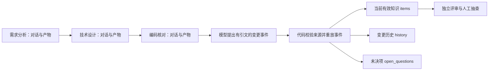

# 完整需求的知识提取与验证

## 输入和处理

`requirement` 命令一次读取一个已完成需求的有序节点，输出当前有效知识及变更依据。节点可以包含需求分析、技术设计、编码或测试。现有 `extract`、`batch` 和 `validate` 仍按阶段运行。



材料先后以节点顺序为准，缺少真实时间戳时不生成日期。每个节点的对话和产物都按原始行号建立索引。早期产物中的决定可以由后续节点更新或撤销。

模型判断哪些内容属于同一知识，并给出稳定的 `knowledge_key`。代码检查事件、原文引用和前驱关系，再生成当前知识。语义是否正确仍需独立评审和人工核查。

## 运行仓库示例

[示例清单](../examples/requirement-cache/manifest.json) 使用完全虚构的商品详情缓存需求，包含分析、设计和编码 3 个节点。先检查输入，无需模型凭证。

```bash
python3 -m decision_memory requirement inspect \
  --manifest examples/requirement-cache/manifest.json
```

准备好 [模型配置](../README.md#配置模型网关) 及进程环境中的凭证后，使用一个新的输出路径。

```bash
python3 -m decision_memory requirement extract \
  --manifest examples/requirement-cache/manifest.json \
  --config config.local.toml --mode verified \
  --output runs/requirement-cache-verified/result.json

python3 -m decision_memory requirement validate \
  --manifest examples/requirement-cache/manifest.json \
  --result runs/requirement-cache-verified/result.json
```

成功后生成 `result.json` 和 `result.md`。第二个命令离线检查输入摘要、引文和事件重放，不调用模型。已有输出会报错，比较实验请使用不同目录。

示例的人工核对重点如下。这些检查点用于说明预期行为，尚未构成模型效果实验。

| 材料中的变化 | 当前知识应怎样表达 | 历史应保留什么 |
|---|---|---|
| 分析阶段允许最多尝试 3 次，设计阶段改为不重试 | 刷新不重试，失败记录日志并返回 | 3 次约定及后续替换依据 |
| 多个节点重复确认订单缓存保持原样 | 保留一条范围约束，可以补充引用 | 支持该事实的节点关系 |
| 设计确认本期不做全量刷新兜底，未给理由 | 保留决定，理由为“未说明” | 确认原文，不能补写原因 |
| 报警阈值始终未确认 | 放入 `open_questions` | 原文中的待确认依据 |

## 准备自己的需求

清单只接受 `schema_version`、`requirement_id` 和 `nodes`。`nodes` 的数组顺序表示先后。每个节点包含唯一 `id`、阶段标签 `stage`，以及相对路径 `dialogue` 和 `artifact`。

```json
{
  "schema_version": 1,
  "requirement_id": "DEMO-1",
  "nodes": [
    {"id": "N1", "stage": "analysis", "dialogue": "analysis-dialogue.md", "artifact": "analysis-artifact.md"},
    {"id": "N2", "stage": "coding", "dialogue": "coding-dialogue.md", "artifact": "coding-artifact.md"}
  ]
}
```

编号使用字母、数字、下划线和连字符，长度为 1～128 个字符。阶段标签不限制为分析或设计。每个节点需要非空对话与产物；不同节点中的产物请保存为各自的文件快照。

路径以清单所在目录为根，不能使用绝对路径、`..` 或指向目录外的符号链接。程序只读取清单列出的材料，不读取同目录下的参考答案。请只在 `dialogue` 和 `artifact` 中填写原始材料。

当前限制为最多 64 个节点、单份材料 2 MB、整个需求 8 MB。模型配置的 `max_input_chars` 还会限制序列化后的请求长度。超过上限会明确报错，程序不会截断材料。

## 读取现有数据集

对于现有 ZIP 或目录格式，程序把同一需求的分析、设计材料按顺序组合。它识别的文件名沿用阶段接口。编码和测试材料需要通过清单明确列出。

```bash
python3 -m decision_memory requirement inspect --dataset data/public-samples.zip

python3 -m decision_memory requirement extract \
  --dataset data/public-samples.zip --requirement-id YOUR-REQUIREMENT-ID \
  --config config.local.toml --mode baseline \
  --output runs/requirement-baseline/YOUR-REQUIREMENT-ID.json

python3 -m decision_memory requirement validate \
  --dataset data/public-samples.zip \
  --result runs/requirement-baseline/YOUR-REQUIREMENT-ID.json
```

将 `YOUR-REQUIREMENT-ID` 换成 `inspect` 返回的需求目录名。提取时必须明确选择一个需求；校验时可以从保存结果读取编号。提取器不读取数据集的评测标注。

## 模式和结果

| 需求级模式 | 常规处理 | 正常模型调用数 |
|---|---|---:|
| `baseline` | 全部节点的对话与产物，一次生成事件 | 1 |
| `verified` | 先生成事件，再用全部原文复核一次 | 2 |
| `artifact-only` | 只向模型提供各节点产物 | 1 |

每步格式或引用错误最多修复一次，HTTP 重试沿用模型配置。实际调用和 token 用量保存在 `calls`、`metrics` 中。阶段级 `verified` 继续使用原来的 3 步流程。

结果中的 `items` 只包含当前有效知识，每条都含结论、理由、边界及逐字段证据。来源编号形如 `D.N1.00002` 或 `A.N2.00003`，分别表示节点中的对话行或产物行。证据保存文件名、原始行号及消息编号，模型输入中的原文索引还标注发言角色。

`events` 保存模型提出并通过校验的操作，`history` 保存版本及状态，`memory_index` 把当前条目关联到知识编号与最新事件。`relations` 表示更新、失效或补充支持。调用模型复核时，可以修订整份事件流，最终结果保留通过校验的版本。

| 操作 | 行为 |
|---|---|
| `add` | 为新知识建立条目，`previous=null` |
| `update` | 替换或重新确认同一知识，提交完整新条目 |
| `invalidate` | 撤销当前知识，保留说明及原文依据 |
| `merge` | 给同一事实补充证据，正文和知识版本不变 |

除新增外，`previous` 必须指向同一 `knowledge_key` 的最新事件，包括合并或失效事件。失效后可用 `update` 重新确认；合并只能作用于当前有效知识。新理由或新边界需要 `update`。

不同业务范围的规则可以共存。例如主链路不重试、旁路允许重试，应使用两个知识编号。未确认提议进入未决项。代码不凭文字相似度自动删除规则。

## 比较质量和成本

先冻结一批未用于调试的需求、原文和人工参考，再用相同材料比较原阶段流程与需求级流程。提取器只接收对话和产物；参考答案只给独立评分环节。调试过的公开样本单独报告。

对于带标注的官方格式数据集，可以把多个完整需求结果放在同一个新目录中，再执行本地评分。

```bash
python3 -m decision_memory official score \
  --dataset data/public-samples.zip \
  --predictions runs/requirement-baseline \
  --config judge.local.toml --scope requirement \
  --output runs/requirement-baseline-score
```

评分前，程序从数据集重建输入，核对保存摘要、输入版本及引用，再把真实原文交给评分模型。同一批次不能混放阶段级与需求级结果。按需求评分旧阶段结果时，目录必须含该需求的全部可用阶段；单阶段比较请用 `--scope stage`。

`official score` 只接受可由其数据集重建的预测。自定义清单的节点编号或材料无法匹配时会拒绝。虚构示例可使用通用 `review init` 评测表并人工逐条审核，不能冒充官方样本成绩。

新报告的主 `recall` 只统计完整覆盖；`recall_weighted` 把部分命中按 0.5 计入，仅作本地辅助。`full/partial` 必须有有效且引用支持的预测；匹配与支持列表双向对应。报告保存预测、来源和评分配置的摘要，`official_score` 为空，人工审核状态为待确认。历史评分不自动换算。

每组比较应保存完整覆盖率、准确率、引用支持度、未审数，以及重复条目、过期决定误收和不同范围误合并等错误实例。同时记录总调用数、耗时、token 用量及每条有效知识的平均成本。单价缺失时保留费用为空。先确认合并有效，再用同一批独立样本判断是否值得增加投票调用。
