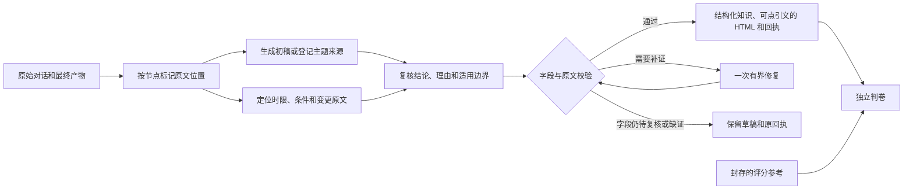

# 方案与实现

## 评审摘要

Decision Memory 从一个已完成阶段的对话与产物中提取可复用知识。输出同时保留结论、理由、适用边界和三者各自的原文。评委可从 HTML 点开引文，按文件、行号和角色核对。

| 评审项 | 方案如何处理 | 可核对的证据 |
| --- | --- | --- |
| 方案创新性（20%） | 先判断规则是否最终生效，再查每个字段由哪段原文支持。可选的独立字段验证把候选改成问题，让下一次请求只读原文作答，最后按字段保留、补引或暂停发布。它针对两类常见失分：复核沿用初稿的错误解释，有关原文出现在别的字段却无法核查当前主张。 | 公开消融分别测量内容覆盖和引文充分性，保留同一正文去掉来源的对照。独立字段验证的能力和质量证据分别记录。[实验](experiment-report.md) · [验证协议](field-evidence-quality.md) |
| 工程合理性（15%） | 默认单阶段两次调用，预算内允许有限结构修复。网关断流时保留回执。结构合格后仍区分机器判卷与人工确认。 | 请求级回放复现答卷。报告逐例记录 HTTP 尝试、耗时和 token。缺少真实价格时金额留空。[运行与费用](judge-run.md) |
| 可落地性（15%） | Python 标准库直接读取官方 ZIP 的阶段材料，输出 JSON、Markdown 和可点原文的 HTML。缺失原因或边界写“未说明”，明确未决另存。 | 官方 ZIP 已验证能识别四个阶段。历史答卷可用原 ZIP 离线复验，无需凭证。模型实际运行需要获准网关。[评委入口](judge-run.md) |

一般摘要只核对正文，逐字定位能核对原文是否存在。本方案再核对正确的来源是否属于正确的字段，及其是否仍适用于当前规则。以公开样本中的批量调用为例，“最多 50 条”和“限制并发”是不同断言。前者的接口限制行无法单独证明后者，理由应同时引用并发控制逻辑及其实际依据。公开开发回溯显示补入这些证据有收益。未见资料上的失败同样保留，默认入口使用已经验证的两步策略。

客观满分需同时达到 90% 识别、95% 准确和 10/10 来源。公开回溯在固定抽查中达到三项满分档，较严格复判和抽检稳定性仍有差距。正式样本和主观评分由出题方判定。 [满分验收与随机抽查](submission-readiness.md#满分目标与抽查稳定性)

## 目标和输入

Decision Memory 从已完成研发协作的原始对话和最终产物中，提取后续工作可复用的知识。输出区分最终结论、理由、适用边界和明确未决事项。

业务口径、职责归属、范围和策略变化与技术限制同样重要。输出不应把已推翻提议、排期、纯接线或未确认假设当作现行知识。

输入范围必须明确。`stage` 只读取给定阶段的一对材料；`requirement` 读取清单声明的有序节点。完整需求是回顾性输入，不能用其结果声称模型在较早阶段已知道后续决定。预测过程不读取评测标注。

## 提取和证据

grounded 正常调用两次模型。第一步依据全部材料生成候选。第二步重新读取全文，修订遗漏、理由、边界、时效和未决事项，并逐字段给出支持判断。模型复核的原始响应及所选证据单独留存，既可用于独立判卷，也可离线重放协议修复。

`evidence-first` 策略把第一步改为按议题登记原文编号，分别标出规则、原因、边界和确认或改写记录。第二步从完整原文合成，先厘清生效状态，再为每个字段选择自己的证据。后续节点局部改写时，需沿用未被改写的早期定义、触发和例外。清单仅提供定位，合成可补充清单外的规则。两次请求都只使用给定范围内的材料及当次产生的清单，不含评测参考。

两种策略共用整行引用校验、协议修复和输出格式。原文优先策略另存 `audit/source-inventory.json`，记录原文索引及输入摘要。CLI 会在第一次请求前检查最小合成请求的字符上限。原文清单格式异常时，可在预算内用同一份材料重新生成，保留原回复。

`witness-review` 是第二次复核的可选策略。它检查同条目各字段已经引用的原文，标出理由或边界写“未说明”但其他字段已有明显线索的情况。如果某段文字在自身引文中找不到、却在同条目其他字段引用的原文中出现，也提示复核。候选只来自正式产物和可辨认的对话参与者。按结构加入的流程标题同样可作为候选。复核仍要核对对象、条件和最终状态，再选择本字段自己的引用。程序不自动添引或改变正文。

相关工作中，ALCE 将内容正确性与引文质量分别评估。长上下文研究观察到改变证据在输入中的位置会影响模型答题表现。本方案据此把来源定位和最终表述分为两个步骤，并用本题材料检验取舍。 [ALCE](https://aclanthology.org/2023.emnlp-main.398/) · [Lost in the Middle](https://aclanthology.org/2024.tacl-1.9/)

发言轮作为模型输入的会话元数据。解析具名 Markdown 和普通 `用户：`、`User:` 发言时保留原文，区分参与者、明确用户与助手。代码与引用块中的文字仍可供核查，其标签不建立发言人身份。复核以本条已引用的原文为锚，结合相邻的同轮续句寻找明确的理由或适用范围，并独立排序后续变更。既有答卷按原有消息编号和协议证明校验。见 [独立盲测](experiment-report.md#发言轮与证据检索的独立盲测)。

跨语言补证试验以字段已有引文中的原文用词检索同条目和相关产物。已诊断样本的同答卷对照中，严格覆盖由 24/28 提高到 27/28。一批新封存材料的离线复判由 24/27 提高到 25/27。最新提取版本借用原文锚点为现有复核提供至多两处候选，以字段支持和最终状态决定是否选择。同时复核并列触发、原文明确的类别和例外。候选不会直接写入引文。见 [独立迁移](experiment-report.md#独立迁移与英文时长恢复)。

本地审计记录原文条件与例外的位置，并按字段标出可能被扩大的范围。沿用旧规则时，只在同主题的前序节点中查找定义。代码、引用示例和时间未知的补充材料不参与条件提示。候选在新封存配对上的合计严格覆盖持平，来源抽查从 8/10 到 9/10。完整需求补齐了一项，单阶段少了一项。默认流程把提示写入 `audit/scope-review.json` 供检查。见 [封存配对验证](experiment-report.md#生效条件提示的封存配对验证)。

第二次复核接收带参照事件的截止原句、范围疑点、一次性操作、同一句混合的待定与决定，以及变更理由需要补证的来源。程序按字段核对工作日、工作小时和自然时长，并把“下一个工作日开门”作为参照事件。程序核对引用和单位，独立判卷核对来源是否足以支持每个断言。两组新材料分别记录实际在线和原回复恢复的结果。见 [截止规则验收](experiment-report.md#截止规则的独立验收)。

工作时间处理支持半天、一个半工作小时和“次一工作日”等写法。工作时间单位与日历参照日分别匹配，分数中的后续数字不会被当成整天数。新校验可重新读取旧版工作时间证明。定点复核的试验要求每处修订带可定位的原文片段，并保留其他字段，用于独立配对。它修正了一处无据承诺，配对严格覆盖持平，评委入口仍使用两次常规提取和复核。见 [定点修订对照](experiment-report.md#只读原文与定点修订的诊断对照)。

复核回复中的“另一天”作为日历参照处理，明确的持续时长按量保存。数值缺少自身引文时，自动补引要求同条目的另一已核查字段已经写明该数值，并引用含该数值的原文。模型核对候选原文是否属于同一规则、对象和有效状态，只返回缺证字段及补充的来源编号。程序保留答卷正文、其他字段和待复核标记，对合并后的整份答卷重新校验。没有可用候选时保存原始草稿。见 [定点补引验证](experiment-report.md#同一初稿的复核与定点补引)。

复核审计还将告知与确认、开放与开场、单向条件与排他限制等疑点定位到相应引文的字符区间。`audit/field-review.json` 记录初稿与已通过结构校验的复核稿，便于分辨错误由哪一步引入和是否延续。规则只定位疑点，字段未触发提醒的答卷仍需语义判卷。

模型只选择真实整行编号。程序填入完整原文、文件、行号和消息角色，消除抄错引文及伪造位置的问题。来源表保留节点顺序，不丢弃中间用户纠偏。来源编号不能代替语义判断：引用一段相关文字，仍可能不足以支撑整句结论。

候选中的缺失符号不在复核前直接淘汰整道题。程序按字段检索真实来源编号，提示不存在于输入的名称，并标出尚未引用的显著产物段。模型据此修订，最终再执行证据准入。提示不自动成为引文，也不能代替独立判卷。

结论、理由和边界分别使用自身的来源。程序核对字段中必要的实现标识符；常见明确用户归因必须包含该字段的真实用户来源。既有系统事实可以出现在 Agent 发言中，不能把所有 Agent 来源拒绝，也不能把未采纳的建议升级为决定。

实现将提取、证据回放和独立质量判定分开。公开四阶段的成对消融中，加入原始对话多覆盖了 8 个有效参考位置。固定同一答案移除来源后，正文覆盖维持 38/42，可追溯条目由 48/51 变为 0/51。另一轮严格复判及新的留出表明字段证据仍是主要缺口，已保留完整用量、判定和未采纳实验。见 [实验报告](experiment-report.md)。

流程正文还需要其标题才能确定对象。对产物中只有一个标题、正文缩进且包含箭头的纯文本 fenced 流程块，引用正文时程序补入同块标题。范围严格限定为同一文件、同一节点和同一流程块；不查找邻近段落，也不借另一字段的证据。JSON 的 `evidence_context` 保存模型原选编号、程序补入编号和结构位置，Markdown/HTML 明示“程序补充的流程标题”。保存后可按原文重建这些记录。标题只能补足结构上下文，不能证明陈述语义正确。

Grounded 检查字段自身的引文是否支持大写下划线常量、至少 10 的裸数值和明示时长。明示时长须与引文中的时长按单位归一化后相等，带逗号的数值按精确十进制数匹配。历史答卷按其保存的规则复算。对象、因果关系和规则的最终状态仍由语义复核判断。复核还会检索未知字段的依据、理由和边界的后续变更，以及未决问题是否已解决。

字段逐字引文试验把最终字段的断言与实际原文片段绑定。程序保留原文行及片段位置，供判卷检查新增范围或理由是否有自己的证据。两份公开答卷的逐字引文与已声明来源相同。合成新增的时长仍可能借用同一行内另一个操作的引文。离线候选按操作子句、时长单位、窗口方向和实现标识符复核了这一缺口，一处开发样例的引用获独立复核支持。评委入口使用已验证的 R3。见 [字段逐字引文对照](experiment-report.md#字段逐字引文对照)。

离线候选在最终条目已有的证据里找回遗漏的生效条件。条件须与原文中的具体动作一并保留。否决引文同时保存先前的提议及后续明确剔除的特征。程序对多条冲突条件或部分已定的备选项给出复核信息。回溯对照的严格覆盖在已诊断组从 24/32 到 27/32。该候选处于实验阶段。见 [适用条件实验](experiment-report.md#生效条件与否决依据的离线修复)。

另一个离线机制把数据定义与实际用途绑定。已经确认的来源需要在产物的事件入口和计数动作中得到相容证据。展示名可能误导时保留原文提醒和具体适用点位。理由或边界缺少约束引文时按同一动作核对，不从同一行的相邻动作借证。两种修复合并后，公开开发回溯的严格覆盖由 37/42 到 42/42。该组合仍待新材料实跑。见 [数据定义和各字段证据](experiment-report.md#数据定义和各字段证据的回溯对照)。

分句候选在该组合上继续核对操作归属、用途和待定范围。比如同一段同时写了某角色可查看和一位匿名用户打开过旧记录，系统按操作及对象核对两个分句，保留匿名观察。权限用途须对应定稿中的同一角色、操作、对象和范围。关联待确认问题时，程序核对有效阈值和问题全文。每处修订可按原输入坐标复算。见 [分句复判](experiment-report.md#操作主体用途与待定状态的配对复判)。

复合条款试验补齐人工确认、同一事件的日期适用范围、收件责任和整笔提交结果。可匹配的原文和适用范围共同约束修订。试验在同一批已诊断材料中提高严格覆盖，独立合成样本暴露了只搜索所引对话和规则表达偏窄的问题。随后试验从已有结论检索同轮对话，让未引用的相关原文进入待复核窗口。此入口记录证据候选，正文是否补写仍需同输入独立验证。见 [迁移验证](experiment-report.md#复合条款补全及迁移验证)。

证据复核候选让语义判断选择已定位的原句，程序负责把具体原句和位置绑定到本条目的理由或边界。回复只提供条目、字段和原句编号。程序核对片段是否列在该条目的候选中、字段是否允许变更，保留既有引文和上下文标签，输出带来源的预览。人工或独立评审复核语义。采用附加模型时，新增调用、用量与原抽取分开保存。见 [字段修订对照](experiment-report.md#从原文候选到可重放的字段修订)。

复核后的字段可以通过通用检索补充证据。程序从该字段文字取罕见精确中文三字片段，只检索本次输入的用户和产物行；每行须补足至少两个此前未覆盖的锚点，每字段最多新增两行，仍受16条来源及8MB展开总量约束。正文、未说明字段、问题和模型不支持标记均不改，用户归因准入先于补充。排序固定，`evidence_retrieval` 保存原选、补入来源和匹配锚点，离线重放与签名防止篡改；文档明确标注程序来源，不称为语义认证。

该规则先固定再作成对实验，满足正文判断不变、既有引用支持无退化、严格覆盖提高及本地三门槛后才接入。生产结果与三个已判卷视图逐字段完全一致，才复用其判卷。收益为两个完整需求的严格覆盖23/32→24/32，未增加模型调用；它没有修复迁移样本中的语义错误。词面相似可能找出相关但不足的引文，全部条目的支持率和十条抽查必须同时报告。

理由和边界缺少依据时为“未说明”。已知解释与剩余未知分别保留；不能为了提高表面准确率删掉难判断的规则，也不能从一个前提扩写未经确认的反向限制。模型复核仍有争议时只保存草稿，不发布成功结果。

旧 `baseline`、`artifact-only` 和 `verified` 保留为对照。旧需求事件模式另存知识的新增、更新和失效历史；grounded 输出最终快照，两种协议使用不同 schema，避免把未经重放的结果冒充历史记录。

## 与相关工作的关系

[LangExtract](https://github.com/google/langextract) 提供来源位置映射、多轮提取和独立 HTML 可视化等通用能力。本项目参考这些问题定义，使用标准库实现整行编号展开、逐字段必要检查和运行报告；没有集成 LangExtract，也不把这些通用部件声称为独创。

[LongMemEval](https://arxiv.org/abs/2410.10813) 将知识更新和拒答列入长期记忆评测能力。本项目对应检查后续决定替换旧值、未知不冒充事实，但没有运行 LongMemEval，也不能把其研究结论当成本项目的效果证据。

本方案重点验证这些机制在研发协作材料中的组合效果：明确输入范围、核对最终状态、分别支持三个字段、保留未知，并让每次模型执行可追溯。是否改善质量和成本，要由相同输入下的独立对照判卷决定。

## 工程运行

运行时仅使用 Python 标准库，模型通过兼容 Chat Completions 的获准网关调用。环境变量承载凭证；配置、报告和源码包不包含真实密钥。MyToken 示例支持配置自定义请求头，实际入口和积分可用性须按所在环境核实。

新 `run` 入口先检查全部输入和实际首次请求大小，再调用模型。HTTP 自动重试关闭；每个模型步骤最多修复一次完整 JSON 的结构或来源关联。截断、断流、认证和计费错误均留存真实回执。执行未知时停止新请求，核对原回执后再决定处理方式。

连接、响应头和正文共用绝对时限，持续滴流也会中断。批次保留调用预算、已知 token、耗时、失败及未启动项；缺失用量和价格保持空值。失败调用、协议修复和草稿都纳入消耗，不能只统计成功答案。

运行生成 JSON、Markdown 和本地 HTML。评委可以点击来源查看原文，也可以打印报告为 PDF。运行入口只记录执行，不给自己判准确率；评分在输出冻结后独立进行。详见 [评委本地运行](judge-run.md)。

## 验证与限制

自动测试验证协议、本机 HTTP/HTTPS、总时限、错误停止、脱敏、保存回放和旧接口兼容。合并前的交付版 `941ff4f` 通过 346 项测试。合并提交 `502de71` 保留来源检索和评委报告，接入补充材料类型及节点顺序，共通过 416 项测试。合并版的真实模型效果待独立复测。

真实自测分别记录单阶段、完整需求和新保留材料。公开附件的阶段参考分配只有本地启发式规则；完整参考自测与阶段诊断分开，保留范围不明条款，不能选择有利分母。关闭来源机制的实验只用于内容诊断，不是可提交结果。

人工确认保持 `pending`，正式成绩保持 `null`。完整质量、来源抽查和成本以固定版本的实验汇总为准。当前方案不训练模型权重；修改来自通用工程机制和可复现错例，而不是把参考答案送入预测过程。

## 工程变更与 Commit 记录

2026-11-19，待提交，基线 `802bd3921f3d`（Merge source-only field verification with the judge runner）。增加 `witness-review` 及最小复核请求预算预检。两份虚构单阶段真实配对共八次提取调用。新策略的一份回复被旧时间规则误拒。修复“班次日志”等措辞中的非日期匹配后，原回复可离线恢复八条，旧答卷按原策略证明重放。默认与新策略合计严格覆盖均为 19/20，来源均为 10/10。条目准确分别为 12/12 和 13/14，单阶段选默认。543 项程序测试通过，正式成绩及实际积分待验证。 [实验报告](experiment-report.md#同条目证据缺口复核)

2026-11-19，待提交，基线 `802bd3921f3d`（Merge source-only field verification with the judge runner）。本地评分增加十条均匀不放回抽查的过线和满分概率，以及全量引文缺口。概率以逐条判卷结果为输入，解决固定随机种子通过掩盖引文缺口的问题。抽取端、冻结答卷和正式评分口径保持原样。已有回溯已离线复算，正式样本的来源支持和人工判断仍待确认。

2026-11-19，待提交，基线 `802bd3921f3d`（Merge source-only field verification with the judge runner）。严格 JSON 入口可恢复完整回复的字符串中未转义的换行、回车和制表符。修复只改 JSON 表示，解析后保留原字段值及引用校验。回执记录修复字符数。复现用例由失败转为通过，截断、尾逗号、非法转义和其他控制字符仍无法通过该恢复。公开四阶段历史答卷引用已复验，正式评分及新网关实测待确认。

2026-11-18，待提交，基线 `802bd3921f3d`。新增字段逐字引文、同正文窗口引用以及断点接续的试验。真实运行了 7 次请求，完成四份独立判卷及一份同正文引文对照。窗口引文改善一条开发样例，严格覆盖仍需提高。六个真实复核步骤等待启动环境凭证，评委正式满分待确认。457 项仓库测试与 23 项试验回归通过。

2026-11-18，待提交，基线 `802bd3921f3d`。补入原文仍生效的条件和理由中缺少的否决依据，重放 8 份 R3 答卷。三份改动由独立上下文重新核对，已诊断组严格覆盖增加三项，较早封存组同分。运行通过 9 项专门回归，新增模型调用为零。新留出实跑、评委凭证环境及正式成绩仍待确认。

同轮复现本地 HTTP 夹具在空闲监听时等待关闭。测试在监听器不自行唤醒时超时。改用本地连接唤醒，停止后回收监听线程。仓库全量 458 项测试通过，耗时 67.136 秒。评委 R3 运行包已再次核对。

2026-11-18，待提交，基线 `802bd3921f3d`。恢复既有数据来源与展示点位的口径，并按操作分句补引文。独立代码评审复现两处范围错误，增加回归并修正。12 项试验回归通过。公开开发回溯达到三个本地满分档，候选和两个未见材料已预注册。真实留出运行、评委网关和正式评分仍待完成。

2026-11-19，待提交，基线 `802bd3921f3d`。离线候选逐句核对操作主体与用途，把尚待确认的动作范围带入对应边界并保留逐字引文。独立代码评审后补齐反例，14 项候选回归通过。相同回执的两例配对复判使严格覆盖增加三项，准确率及全量引文均为 30/30。解包实测八例生成 JSON、HTML 和 Markdown。候选已登记两份新留出验证，等待模型网关凭证和正式判卷。

2026-11-19，待提交，基线 `802bd3921f3d`。补全四类复合条款并用同回执配对盲评。已有诊断组严格覆盖从 27/32 到 31/32，独立合成样本的可补内容为 0/4。随后的证据窗口检索在单独封存的六例中召回 5/6 条目标原文。两项试验共 21 项专门回归通过，独立评审提出的 13 个反例复验通过。新增模型请求为 0，真实留出和正式评委核验待完成。

2026-11-19，待提交，基线 `802bd3921f3d`。新增按原句编号选择和重建字段的离线路径，保留候选与用量的可验证回执。六例独立合成验证补中四个目标字段，两例保留原答卷。14 项候选测试、八份历史实跑回执的解包验证和本机 HTTP 联调通过。新留出预注册已完成，模型网关凭证和正式判卷仍待确认。

2026-11-19，待提交，基线 `802bd3921f3d`。从打包的 R3 入口读取原始材料，对照历史回执重放八份答卷及两次协议修复。全部答卷通过引用校验，变更后的请求无法取得历史回复。四阶段消融统计精确复算，新增外部网关请求为 0。两份新留出与正式评委评分仍待验证。

2026-11-19，待提交，基线 `802bd3921f3d`。在公开 ZIP 和历史清单副本中替换或添加评测标注，检验标注是否会流入提取和补证。18 个提取请求、八份答卷和八份补证请求准备稿与基准一致，结果中未出现标注标记。新留出实跑与正式评分仍待验证。

2026-11-19，待提交，基线 `802bd3921f3d`。使用固定 R3 包完成两份预先封存材料的在线运行与独立判卷。四次调用全部完成，三组比较的答卷视图相同。严格覆盖 17/32，准确条目 28/30，来源抽查 5/10，全量引文充分 21/30。缺口包括原文已有范围的遗漏和会话角色识别。正式评分待确认。

2026-11-19，待提交，基线 `802bd3921f3d`。修复具名发言轮漏识别，利用本条原文和同轮续句检索字段证据。首个冻结版在两份新盲测材料的内容完整覆盖为 28/28，严格覆盖为 24/28，准确条目为 28/29，来源抽查为 9/10。代码评审后的加固版本通过 464 项测试，两份旧答卷原文校验通过。当前缺口是跨语言引文和一次性操作筛选，正式评分待确认。

2026-11-19，待提交，基线 `802bd3921f3d`。明示时长支持完整英文单位，区分自然时长与工作日。加固版 466 项测试通过。用原始网关回复离线恢复误拒的完整需求，在现有评委入口生成三个报告格式并核对证明。独立迁移复判的严格覆盖为 25/27，准确条目及全量引文均为 25/25，来源抽查 10/10。该组含一份离线恢复答卷。正式评分待确认。

2026-11-19，待提交，基线 `802bd3921f3d`。接入跨语言候选和范围复核，随后修复普通中英文发言轮及代码与引用块误判。两份同材料实跑均在两次调用内产出答卷，最终加固版精确回放全部请求并通过 471 项测试。严格覆盖 15/24，准确条目 21/25，来源抽查 7/10。提交前仍需验证适用条件和字段语义覆盖的改善。见 [同材料复跑](experiment-report.md#普通发言格式与同材料复跑)。

2026-11-19，待提交，基线 `802bd3921f3d`。新增条件与例外的可回查位置，以及分字段的范围提醒和前序定义查找。两份新封存材料的在线配对均为 18/21 严格覆盖、19/22 准确。条件提示保留用于本地审计。补上常见拼写时长校验，用真实回执离线复现两处漏引并验证补证。同文本独立判卷的需求严格覆盖从 9/11 到 10/11。全量 482 项测试通过，新时长校验仍待新材料在线验证。见 [封存配对验证](experiment-report.md#生效条件提示的封存配对验证)。

2026-11-19，待提交，基线 `802bd3921f3d`。在第二次复核加入有限的截止、作用范围、一次性操作与变更确认提示。第一组新材料均从评委入口完成，严格覆盖、准确条目均为 21/22，来源抽查 9/10。第二组遇到清单格式差异和工作时段误拒，已适配清单并用原回复验证时长与参照事件分离。两组判定及失败保留，连续达到三项本地满分档和正式评分仍待验收。见 [截止规则验收](experiment-report.md#截止规则的独立验收)。

2026-11-19，待提交，基线 `802bd3921f3d`（Merge source-only field verification with the judge runner）。新增日期参照与时长的区分、同字段缺证候选、截止时点是否包含的定位。新阶段实跑达到 9/10 严格覆盖、10/10 准确和来源 10/10。新完整需求原运行失败，增加一次真实修复后得到 9/10 严格覆盖、11/13 准确和来源 10/10。最新入口用存档回复重放并校验输出。更新后的截止提示仍待真实模型复测，正式评委环境和成绩待确认。见 [最新独立复测](experiment-report.md#最新默认入口的独立复测)。

2026-11-19，待提交，基线 `802bd3921f3d`。截止提示在再封存材料实跑，单阶段答卷独立判为 7/10 严格覆盖、9/12 准确、8/10 来源。完整需求新增普通英文单数时长等值校验，离线接受旧校验误拦的末次回复。原运行与恢复答卷保留。合并诊断为 11/20、17/24、7/10。510 项程序测试通过，回放通过 CLI 两次调用与自动报告。跨节点事件与适用范围仍影响质量，真实评委环境和正式成绩待确认。见 [再验证](experiment-report.md#截止提示后的再验证)。

2026-11-19，待提交，基线 `802bd3921f3d`（Merge source-only field verification with the judge runner）。增加字段疑点审计和只追加来源的定点补引。真实补引在 4.664 秒内补入完整需求的旧时长原文。加固后的 CLI 按同条目证据约束离线回放，答卷及报告通过校验，全量 532 项测试通过。缩短化复核在同题诊断中改善部分条目，完整需求初次校验失败，并且补引后覆盖和来源仍低于基准。缩短化复核暂保留在对照实验，通用语义和正式评审结果待验证。见 [同题诊断与补引](experiment-report.md#同一初稿的复核与定点补引)。

2026-11-19，待提交，基线 `802bd3921f3d`（Merge source-only field verification with the judge runner）。实现可配置的原文优先提取。两步先定位来源再合成结论，减少初稿扩写被带入复核，保留未被改写的早期规则。程序验证 536 项通过，旧答卷可继续引用校验。新封存组四例共 16 次真实模型调用，8 份答卷均完成。单阶段采用默认策略，本地判卷为 20/20 严格覆盖、18/18 准确和来源 10/10。原文优先用于完整需求，本地判卷为 19/20、27/27 和 10/10，输入 token 少 34.3%。上述为实跑与模型判卷，本轮实际积分、统一样本及正式评委成绩待确认。 [配对验收](experiment-report.md#原文优先提取配对验收)
